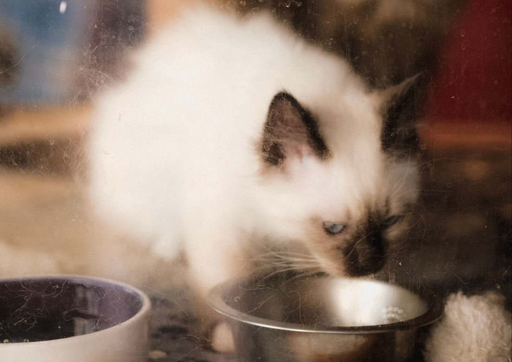

<div align="center">

<h1>Catabase</h1>

<h3>Cat Adoption & Shelter Management System</h3>

<p>
  CS340 Fall 2026 · Group 77<br>
  Kaia Bahar · Max Riley · Ashley Davis
</p>



</div>


## Project Description

**Catabase** is a database system for managing a cat shelter's adoption requests and foster placements. It uses six tables: Cats, Adopters, StaffMembers, FosterHomes, AdoptionRequests, and FosterAssignments. The two intersection tables represent M:N (many-to-many) relationships between adopters and cats, and also between cats and foster homes.

This project follows a three-tier structure:
1) a MySQL database
2) a Python application-tier class (CatabaseDAO)
3) a test driver

The class provides READ operations for all six tables, and CREATE, UPDATE, and DELETE operations for the intersection
table AdoptionRequests. Queries are the class methods, and have parameterized SQL for values that are supplied. The Python test driver demonstrates these operations and prints their results.

## Requirements & Installation
The following are required: Python 3, a local running MySQL server, and your MySQL login credentials. 
Keep DDL.sql, catabase_dao.py and test_driver.py stored in the same project folder. 


### macOS / Linux
Open Terminal while you are in this project folder and install the required Python dependency:
```sh
python3 -m venv venv
source venv/bin/activate
python3 -m pip install mysql-connector-python
```


### Windows PowerShell
Use Python if needed and then activate with:
```powershell
python -m venv venv
.\venv\Scripts\Activate.ps1
python -m pip install mysql-connector-python
```


### Catabase Database Setup

Start your local MySQL server. While in your project folder, run the below command - replacing YOUR_USERNAME with your MySQL username, which is likely root:

```sh
mysql -u YOUR_USERNAME -p
```

After entering your username and pressing Enter, your will be prompted for your MySQL password. Type in your password. Press Enter.

If you get the following message: `command not found: mysql` and MySQL is installed at
`/usr/local/mysql`, instead use the following command:
```sh
/usr/local/mysql/bin/mysql -u YOUR_USERNAME -p
```

When you successfully see the mysql> prompt, then run:
```sh
CREATE DATABASE IF NOT EXISTS Catabase;
USE Catabase;
SOURCE DDL.sql;
SHOW TABLES;
EXIT;
```

The above commands will create and select Catabase, and import its sample data and six tables. Importing the DDL will replace any existing project tables, thus use a test database. SOURCE DDL.sql assumes you started the MySQL client from the project folder. 


## Run the Application

In your local copy of test_driver.py, replace the placeholders accordingly:
```py
db = mysql.connector.connect(
    host="localhost",
    user="YOUR_MYSQL_USERNAME",
    password="YOUR_MYSQL_PASSWORD",
    database="Catabase"
)
```

Replace YOUR_MYSQL_USERNAME with your MySQL user name and replace YOUR_MYSQL_PASSWORD with your password.
localhost indicates that the server is on your computer. In the case that you used a different name, change the database. 

While the virtual environment is active and the terminal in your project folder is open, run:
```sh
python3 test_driver.py
```

On Windows, if your Python command is python, use:
```sh
python test_driver.py
```

The test driver will then run automatically. Note that both Python files must be located in the same project folder. And use the DDL sample data, as it requires at least two cats, two adopters, and one staff member.


## Expected Output & CLI Output
The test driver will print:

    - All six table records
    - Four new adoption requests, covering all combinations of supplied/NULL reviewers and notes
    - Four UPDATE results: each showing 1 row(s) affected, and changed records
    - Four DELETE resultsL each showing 1 row(s) affected, and the original five requests 
    - A confirmation message that testing is finished and the connection has closed.

Dates: appear as datetime.date(...).
None: represents SQL NULL.
Note that the generated request IDs may differ between different runs.


To save the CLI output, run:
```sh
python3 test_driver.py > CLI_OUT.txt 2>&1
```

For Windows, use python in place of python3 as needed.


## Citations
Our team designed and adapted our project using OSU CS340 lectures and activities.
The highlighted course materials used were the following:

- Curry, M. (November 2026). *Activity 2 — Python App to Demo 3-Tier*. CS340, Oregon State University. [Course Material]. https://canvas.oregonstate.edu/courses/2061186/assignments/10623022?module_item_id=27088329 
- Curry, M. (November 2026). *Python CRUD Query App Assignment — Local Testing Example*. CS340, Oregon State University. [Course Material]. https://canvas.oregonstate.edu/courses/2061186/assignments/10623045?module_item_id=27088392 
- Curry, M. (November 2026). *Exploration — Designing a Python Class for Database CRUD Operations*. CS340, Oregon State University.[Course Material]. https://canvas.oregonstate.edu/courses/2061186/pages/exploration-designing-a-python-class-for-database-crud-operations?module_item_id=27088390
- Curry, M. (November 2026). *Exploration — Connecting Python to MySQL and Build a CRUD CLI*. CS340, Oregon State University. [Course Material]. https://canvas.oregonstate.edu/courses/2061186/pages/exploration-connecting-python-to-mysql-and-build-a-crud-cli?module_item_id=27088391 
- Curry, M. (November 2026). *What is CRUD?* and *Sample Data Manipulation Queries*. CS340, Oregon State University. [Course Material]. https://canvas.oregonstate.edu/courses/2061186/pages/what-is-crud-2?module_item_id=27088389 

Images:
- Reding, M. (November 2026)  Black and White Cat Eating on Bowl, Pexels. [Online]. https://www.pexels.com/photo/black-and-white-cat-eating-on-bowl-12467776/

